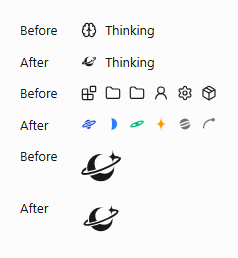
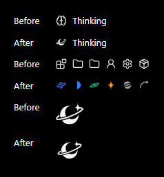
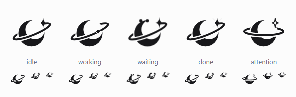
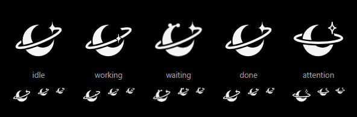
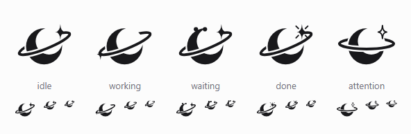
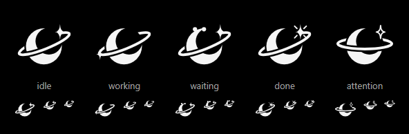
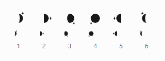
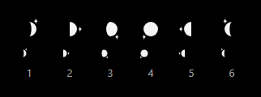

# QA: the living mark

Plan: [plans/mascot.md](plans/mascot.md). Decision: D-67. Checked on 2026-11-12, Windows 11,
Chromium from the web browser test project (Playwright 1.60, headless shell 148).

## Before and after

The working indicator in the timeline, the skill source icons in the slash menu, and the mark.

| Light                                                               | Dark                                                              |
| ------------------------------------------------------------------- | ----------------------------------------------------------------- |
|  |  |

## The five states

With motion, frozen a third of the way through a lap (the working star is crossing the moon):

With `prefers-reduced-motion: reduce`. Every state still differs in shape: working moves the star
to the ring's far end, waiting adds two dots, done adds rays, attention levels the ring and hollows
the star.

Each row also shows 32, 20 and 16 px. At 20 px and below the ring is drawn heavier, as `smallMark`
does for favicons.

## Council seats

Moon phase and star position, at 32 and 16 px:

## Automated checks

`apps/web/src/components/brand/LivingMark.browser.test.tsx`, in real Chromium:

- The travelling star sits on the ring's ellipse within a pixel at four points of the lap, and keeps
  a square box a fifth of the mark wide, so the nested transforms cancel to a slide: no turning, no
  stretching.
- Each state shows its own set of shapes.
- With reduced motion no animation runs in any state, and the working and done stills show.
- The six seats and six skill kinds draw six different glyphs each; seat 7 wraps to seat 1.

Generated data: `node scripts/render-brand-icons.ts --check` fails when the geometry and its
generated copy disagree; CI runs it.

## Motion and performance

- Transforms and opacity only. The lap is two rotations on nested layers; nothing else repaints.
- Only working loops. Waiting breathes eight times and rests; done plays once; idle twinkles three
  times, and only where asked (welcome, empty thread, About).
- The lap pauses off screen and in a hidden tab where its row is observed by
  `observeVisibleAnimation`, like the existing shimmer.
- Nothing changes faster than three times a second.

## Not checked

- A Chromium performance trace of a long-running working state in the real app. The design keeps
  the lap on the compositor; it was not measured.
- The real app by eye (web, desktop and phone). The captures are of the components.
- Forced-colors mode. The mark uses `currentColor`, so it follows the system colour.
